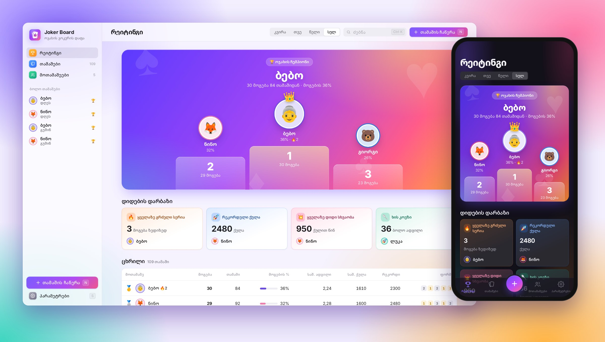

<p align="center">
  
</p>

<h1 align="center">Joker Board</h1>

<p align="center">A cheerful scoreboard for family <b>Joker</b> nights.</p>

---

My family plays Joker, the Georgian card game, every single day. After every game someone always asked *"so who's winning this month?"* and nobody could remember. So I built Joker Board: we write down each game's final scores, and it keeps the leaderboard, win streaks and records for us.

<p align="center">
  
</p>

- 🏆 **Leaderboard** with a podium, win rates, form and a "race" chart, filterable by week, month, year or all time
- 🔥 **Hall of fame**: longest win streak, record score, biggest win and the 🥄 wooden spoon
- ✍️ **Quick logging**: pick the four players, type their scores, done
- 📱 Works on phones and desktops, in light and dark mode. Add it to your home screen
- 🇬🇪 The interface is in Georgian
- 💾 One JSON file holds all the data. Export and import backups from Settings

## Self-hosting

**With Docker** (recommended):

```bash
git clone https://github.com/nlortkipa/joker-board.git
cd joker-board
docker compose up -d
```

Open **http://localhost:3000**, or `http://<your-LAN-IP>:3000` from any phone or laptop on the same network, and you're done. Your data lives in the `joker-data` volume.

To put a password on it, uncomment `BASIC_AUTH` in [`docker-compose.yml`](docker-compose.yml).

**Without Docker** (Node.js 20+):

```bash
npm install
npm run build
npm start            # prints the Local and Network (192.168.x.x) URLs
```

| Variable     | Default  | Description                              |
| ------------ | -------- | ---------------------------------------- |
| `PORT`       | `3000`   | Port to listen on                        |
| `HOST`       | `0.0.0.0`| Interface to bind (all interfaces by default, so it's reachable on your LAN) |
| `DATA_DIR`   | `./data` | Where `joker.json` is stored             |
| `BASIC_AUTH` | none     | Optional `user:password` for the whole site |

## Development

```bash
npm install
npm run seed         # optional: fill in a few months of demo games
npm run dev
```

## License

[MIT](LICENSE)
